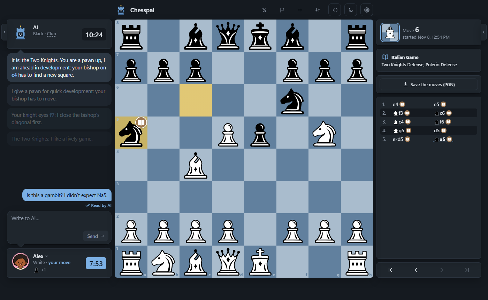

# Chesspal

Play chess against an AI on a real board, or learn with one.



## Get started

You need [Node.js](https://nodejs.org) 22.13 or newer and an AI agent on your computer, [Claude Code](https://code.claude.com/docs/en/setup) or [Codex](https://developers.openai.com/codex): see [what you need](#what-you-need). Open a terminal and type:

```bash
npm install -g chesspal
chesspal init chess
cd chess
claude
```

- `npm install -g` installs the `chesspal` command for the whole computer, where your agent finds it.
- `chesspal init chess` makes the folder `chess` to play in. Any name will do; your games are kept [elsewhere](#where-your-games-are).
- `claude` opens Claude Code in that folder; with Codex, type `codex`, then `/hooks`, and allow Chesspal's two hooks. In the Claude desktop app, choose the folder in the Code tab instead.
- The first time, your agent asks whether you trust the folder: say yes.

Then **say hello**. The AI answers with the link to the board page: open it in your browser, tell it who you are, and ask for a game. You choose your colour, the clock and the AI's level, and play on the board.

On Windows, use Command Prompt (press Start, type `cmd`, press Enter): PowerShell refuses npm's commands until its scripts are allowed.

## What it does

An AI in a plain chat forgets the position, plays illegal moves and sees no board. Chesspal is what it lacks: it **keeps the rules, the board, the clock and your games**; the AI **plays, reasons and talks**. Every move is checked by Chesspal, and no chess engine plays for the AI: every judgment is its own, made from the facts Chesspal hands it, such as the legal moves, the pieces attacked and defended, the pins and the opening's name.

- **Play on a board** in your browser, and talk with the AI there or in the chat.
- **Choose its level**, from beginner to master: the higher, the more of the position the AI sees.
- **Play with a clock**, against an AI that knows how much time it has left; offer a draw, resign, save the game as PGN.
- **Go over a game** with the AI when it is over: its notes show on the board page, in Analyses. Games from other sites come in as PGN files.
- **Keep a profile** for each player at the same computer, with their games.

Coming later: an AI coach that helps you grow, exercises chosen on your weak points, a rating worked out from your games, an opponent with a character and moods of its own, and local models.

## What you need

- **Node.js 22.13** or newer: download the version marked LTS and install it like any program.
- **An AI agent** with your own subscription: Claude Code, with a paid Claude plan, or Codex, with a ChatGPT account. Chesspal never uses an API key, which is paid by the call: sign your agent in with your account.
- **A web browser**, for the board page.

Chesspal works with any agent that supports MCP tools and can work with the files on your computer: we develop it with Claude Code, and Codex is connected too.

## Good to know

- **For the next game**, type `/clear` in the chat or start a new one: a long chat makes the AI slower and costs you more.
- **A move written in the chat** counts too: `e4`, `Nf3`, in the international notation (K Q R B N in every language), or in words.
- **To update**, close the chat, run `npm install -g chesspal` again, then `chesspal init` in your folder: it updates its own lines and keeps what you wrote there. In Codex, allow the hooks again when it says so.

## Where your games are

In one folder for every folder you play in:

- Windows: `Documents › My Games › Chesspal`, inside OneDrive if you use it;
- macOS: `Documents › Chesspal`; Linux: `Chesspal` in your Documents folder.

The board page shows where, and its **Open the folder** button opens it. To back up your games, copy that whole folder; to move them to another computer, put the copy in the same place there. Do it with the chat and the board page closed.

## Try it, and tell us

Chesspal is in early development: the version on npm is a first one to try, and it may change from one release to the next. When something breaks, confuses you or could work better, open an [issue on GitHub](https://github.com/stefanocaronia/chesspal/issues): what you did, what you expected, what happened.

## Development

Chesspal is an MCP server, a command line and a board page, all made from the same commands, which check every move with [chess.js](https://github.com/jhlywa/chess.js) and write the games atomically.

```bash
git clone https://github.com/stefanocaronia/chesspal.git
cd chesspal
npm install
npm run build
npm test
```

[The guide for development](https://github.com/stefanocaronia/chesspal/blob/main/AGENTS.md), for people and AI coding agents alike, holds the other scripts, the layout, the architecture's rules and the coding guidelines.

## Credits

- The rules: [chess.js](https://github.com/jhlywa/chess.js), under the BSD 2-Clause license.
- The openings' names: Lichess's [chess-openings](https://github.com/lichess-org/chess-openings), under CC0.
- The pieces: the Torretta and Nitida sets are Chesspal's own; cburnett is by Colin M.L. Burnett, under the BSD 3-Clause license. [The piece sets' credits](https://github.com/stefanocaronia/chesspal/blob/main/src/page/pieces/CREDITS.md) name every author, licence and source.

Chesspal ships only original or open-licensed content, and no GPL dependency.

## License

[MIT](https://github.com/stefanocaronia/chesspal/blob/main/LICENSE).

## Development notes

Developed with the help of AI coding agents. Everything is designed, reviewed and tested by the project's human maintainer.

**We encourage everyone to use AI for their own purposes.**\
The means of production should belong to the people.\
Fight corporate control of technology, not our right to use it.

---

© 2026 [Stefano Caronia](https://stefanocaronia.it) · [GitHub](https://github.com/stefanocaronia/chesspal) · [npm](https://www.npmjs.com/package/chesspal)
